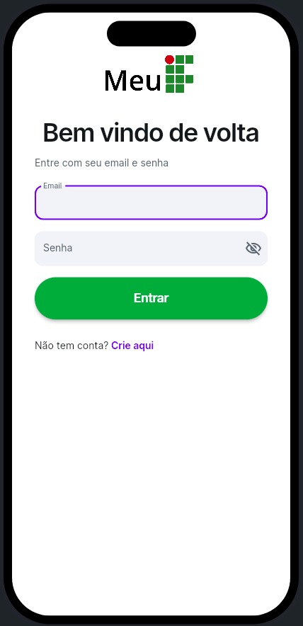
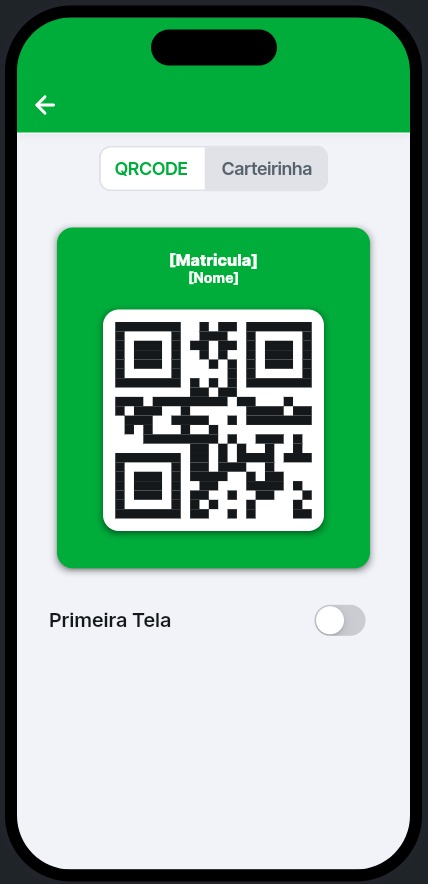
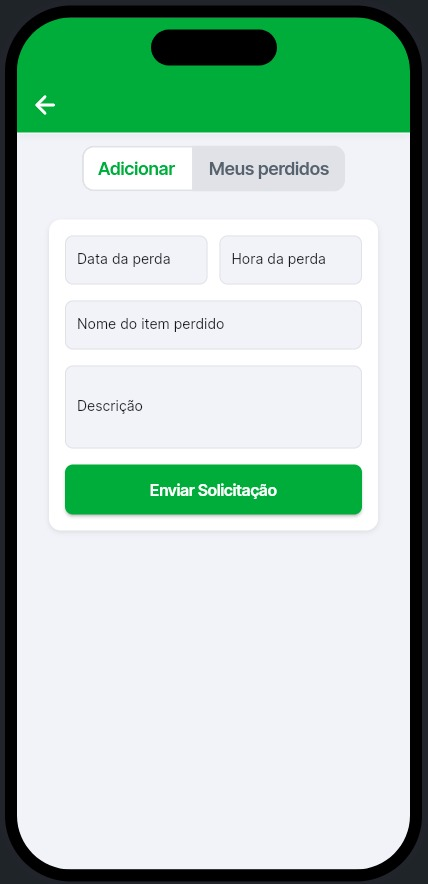

# MeuIF

Aplicação académica multiplataforma do IFPR Campus Cascavel (Brasil). Reúne num só lugar o cartão de estudante digital, o registo de entradas e saídas, as autorizações, a agenda da turma, a ementa do refeitório e os perdidos e achados.

Esta versão é uma reengenharia da app criada em 2023. Foi refeita em Flutter para funcionar em Android, iOS e web a partir de uma única base de código.

<!-- Prints: use dados fictícios, sem nomes ou matrículas reais de alunos -->
<p align="center">
  
  
  
</p>

## Funcionalidades

| Módulo | O que faz |
| --- | --- |
| Cartão de estudante | QR Code único por aluno, disponível offline, lido nos leitores de entrada e saída do campus |
| Entradas e saídas | Registo automático de data e hora em cada leitura do QR Code |
| Autorizações | A secção pedagógica (SEPAE) autoriza entradas atrasadas e saídas antecipadas; aluno, professor e portaria consultam |
| Agenda | Comunicados por turma ou para todo o campus, criados por delegados de turma, professores e SEPAE |
| Refeitório | Ementa diária ou semanal e registo de levantamento do lanche |
| Perdidos e achados | O aluno regista o objeto; quando a SEPAE o marca como encontrado, o aluno recebe uma notificação |
| Frequência | Histórico de presenças, faltas, entradas e saídas do aluno |

### Perfis de acesso

Cada utilizador tem um perfil com permissões próprias, aplicadas por regras de segurança no Firestore:

- **Aluno:** cartão, frequência, autorizações, agenda, ementa, perdidos e achados
- **Delegado de turma:** tudo o que o aluno vê, mais a gestão da agenda da turma
- **Professor:** autorizações dos alunos durante as suas aulas e agenda da sua disciplina
- **Portaria:** registos de entradas e saídas e respetivas autorizações
- **SEPAE:** gestão de utilizadores, autorizações, ementa, perdidos e achados e agenda de qualquer turma

## Tecnologias

- **App:** Dart, Flutter
- **Autenticação:** Firebase Authentication
- **Dados:** Cloud Firestore, MongoDB
- **Prototipagem:** FlutterFlow
- **Modelação:** diagramas UML (casos de uso e classes) no Draw.io
- **Gestão:** Kanban no Trello, Git e GitHub

As APIs que ligam a app à base de dados foram desenvolvidas num trabalho paralelo, "Desenvolvimento da Infraestrutura de Serviços para o MeuIF Multiplataforma".

## Resultados

Teste de 4 semanas com 35 alunos do campus, comparado com um questionário feito antes da reengenharia:

| Pergunta | Versão anterior | Nova versão |
| --- | --- | --- |
| Estabilidade (sem falhas ou travamentos) | 20% nunca tiveram problemas; 15% relataram dificuldades extremas | 93,33% positivas; nenhuma negativa |
| Experiência de utilização | Nenhuma avaliação excelente; 15% terrível | 93,33% positivas (53,33% excelente); nenhuma negativa |

O projeto foi selecionado no edital IFTECH 2025 do IFPR Campus Cascavel, que financiou leitores de QR Code para mais pontos do campus.


## Estrutura do projeto

```
lib/
├── main.dart                  # ponto de entrada da app
├── app_state.dart             # estado global partilhado entre ecrãs
├── index.dart                 # exporta todos os ecrãs para a navegação
├── auth/                      # autenticação com Firebase Authentication
├── backend/
│   ├── firebase/              # configuração do Firebase
│   ├── schema/                # coleções do Firestore (users, alunos) e tipos de dados
│   └── api_requests/          # chamadas à API REST (ementa do refeitório)
├── criar_login/               # login e criação de conta (aluno e servidor)
├── paginas_aluno/             # ecrãs do aluno: principal, cartão, agenda, autorizações,
│                              #   entradas e saídas, refeitório, perdidos e achados
├── paginas_sepae/             # ecrãs da SEPAE: autorizações, ementa,
│                              #   gestão de perdidos e achados
├── componente/                # componentes reutilizáveis (cartão, perfil, autorização...)
├── home17_calendar/           # calendário da agenda
└── flutter_flow/              # utilitários, tema e navegação gerados pelo FlutterFlow

firebase/
├── firestore.rules            # regras de segurança do Firestore
├── storage.rules              # regras do Firebase Storage
└── functions/                 # Cloud Functions em Node.js

assets/                        # imagens, ícones e logótipos
android/ · ios/ · web/         # projetos de cada plataforma
```

## Equipa

Trabalho de conclusão do Curso Técnico em Informática Integrado ao Ensino Médio, IFPR Campus Cascavel, 2025.

| Nome | Contribuição |
| --- | --- |
| Arthur Gamba Borba |Produção do artigo, Design do aplicativo, Engenharia do aplicativo, Levantamento de dados, Modelagem UML, Regras de negócio, Aplicação da LGPD, Desenvolvimento do Aplicativo|
| Marcelo Cappellaro Macedo |Produção do artigo, Design do aplicativo, Engenharia do aplicativo, Regras de negócio, Desenvolvimento do Aplicativo, Autenticação do Firebase, Migração de dados|

**Orientadores:** Prof. Fernando de Lima Alves e Prof. Odair Moreira de Souza

📄 [Artigo do TCC](assets/pdfs/Artigo.pdf): *Reengenharia do sistema estudantil MeuIF: transformação em aplicativo multiplataforma baseado em design centrado no usuário*